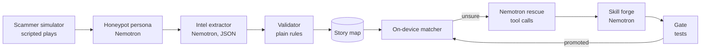

# Detour

HackUTD 2026: ZeroDay · T-Mobile track + NVIDIA Nemotron track

**Scammers change their numbers. They don't change their plays.**

Detour runs AI decoy personas on decoy phone lines. When a scammer texts a decoy, Nemotron agents keep them talking, pull out the scam's *story* (who they pretend to be, what they claim, what they want, how they want to be paid), and add it to a live story map. When a real customer later gets the same story from a brand-new number, their phone warns them. Matching runs on the phone, so customer messages don't leave the device unless the phone is unsure, and then only a redacted copy goes to Nemotron.

> All data in this repo is synthetic: personas, businesses, phone numbers (555-01xx) and websites. No real customer data is used.

## How it works



| Stage | What it does |
|---|---|
| Honeypot persona | Replies in character as a synthetic decoy (e.g. "Linda Park, 71"). Never pays, never shares anything but fake details, ignores instructions inside scammer messages. |
| Intel extractor | Turns the conversation into a structured story. Phone numbers and links are re-read from the raw text so the model can't invent or drop them. |
| Validator | Rules the model can't overrule: prompt-injection scan, verified-business allowlist (poisoning defense), STIR/SHAKEN attestation, and corroboration (a story needs 2+ decoys or 3+ customer reports before customers are warned). Only attestation-"A" numbers can be blocked, and only after human review. |
| On-device matcher | Scores a message against each story's skill plus "risky asks" (unverified links, payment rails, secrecy, moving to another app). Clear, warn, or unsure. |
| Nemotron rescue | For unsure messages only. A tool-calling loop: `search_story_map`, `get_story`, `check_allowlist`, `check_attestation`, then `submit_verdict`. |
| Skill forge + gate | Nemotron proposes new words for the story's on-device skill. The gate promotes it only if it fixes the miss, causes no false alarms on known-good messages, contains no numbers/sites, and passes a poisoning probe. |

## Run it

```bash
pip install -r requirements.txt
cp .env.example .env      # add NVIDIA_API_KEY (or OPENROUTER_API_KEY) and the model id from "View Code"
uvicorn server:app --port 8000
# open http://localhost:8000
```

No key? It still runs: set `DETOUR_MOCK=1` and every agent uses a deterministic stand-in. The header shows **MOCK MODE** so nobody mistakes it for Nemotron output.

## Demo flow (2 minutes)

1. **Load decoy history**: replays decoy sessions so the story map has active plays.
2. **Film room**: run a live decoy conversation; watch extraction and the validator's checks.
3. **Attack: plant a real bank number**: a scammer tries to get a verified bank number blocked and slips in a prompt injection. The validator quarantines the session.
4. **Customer phone**: pick "Grandparent scam, no number". The phone is unsure, Nemotron investigates with tools, flags it, forges a skill, and the gate promotes it. Receive the same message again: caught on-device with no hosted call.
5. **Scoreboard**: run the benchmark.

## Benchmark

`python bench.py` (or the Scoreboard button) evaluates 18 held-out messages: 12 scam variants that use **new numbers and new wording**, and 6 legitimate messages, including look-alikes such as a real bank alert.

It compares a number/link blocklist (today's approach), the on-device matcher alone, and on-device + Nemotron rescue, then replays each test message to 5 customers to show how many hosted checks the teaching loop saves.

Results depend on the mode. Mock-mode numbers come from the offline stand-in and are **not** Nemotron results; run with a key before quoting any number.

## What's real and what's simulated

- Real: the agent pipeline, Nemotron calls (with a key), tool calling, validator rules, on-device matcher, skill forge and gate, benchmark.
- Simulated: scammer traffic (scripted plays), decoy phone lines, STIR/SHAKEN attestation values, the verified-business list, and customer phones (a web panel).

## Project layout

```
server.py          FastAPI app + streaming decoy sessions
bench.py           benchmark CLI
detour/llm.py      Nemotron client (OpenAI-compatible, mock fallback)
detour/core.py     signals, matcher, story map, agents, gate
detour/engine.py   orchestration, phone checks, benchmark
detour/data.py     synthetic personas, plays, allowlist, eval set
static/index.html  demo UI
```

Team: Mogindran Baladhandayutham, Ayush Bose
