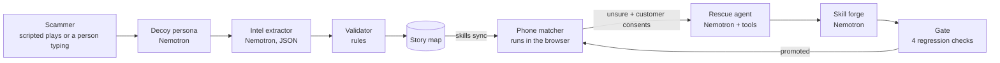

# Detour

HackUTD 2026: ZeroDay · T-Mobile · NVIDIA · PNC

**Nemotron learns from attackers, then teaches a tiny on-device skill. Every lesson passes regression checks before it ships.**

Scammers swap phone numbers in hours, but they keep the same story. Detour runs Nemotron agents as decoy personas on decoy lines. They pull the *story* out of each scam conversation: who it pretends to be, what it claims, what it asks for, and how it wants to be paid. Rules the model can't overrule validate that story. It then becomes a few-KB skill that customer phones use to recognize the same play from a brand-new number.

> All data in this repo is synthetic: personas, customers, businesses, phone numbers (555-01xx) and websites (.example). No real customer data is used.

## How it works



| Stage | What it does |
|---|---|
| Decoy persona | Replies in character as a synthetic decoy (e.g. "Linda Park, 71"). It never pays and never shares anything real. It ignores instructions inside scammer messages, and a filter stops it from revealing it's an AI. |
| Intel extractor | Turns the conversation into a structured story. Phone numbers and links are re-read from the raw text, so the model can't invent or drop them. |
| Validator | Rules the model can't overrule: a prompt-injection scan, a verified-business allowlist (poisoning defense), a sender-registration check (A2P short code / 10DLC, simulated), and corroboration. A story warns customers only after 2 independent decoy lines. A typed-in live session or customer reports can add at most one confirmation, and only to a play a decoy line has already seen. |
| Phone matcher | Runs in the browser (`static/matcher.js`), which stands in for the phone. It scores a message against each story's skill (weighted keywords and phrases) plus "risky asks": unverified links or callback numbers, payment rails, secrecy, moving to another app, disguised text. The result is warn, clear, or unsure. Only the verdict goes to the server for the dashboard counters; the message itself is never sent. |
| Rescue agent | Runs only for unsure messages, and only after the customer taps consent. The phone sends a redacted copy (card numbers, SSNs, codes, addresses, emails and the owner's name removed) plus the sender ID. Nemotron then works through a tool loop of at most 6 steps: `search_story_map`, `get_story`, `check_allowlist`, `check_sender_registration`, `check_attestation`, `submit_verdict`. A policy layer downgrades any verdict that has no tool evidence, and it never marks a message with a payment ask as safe. |
| Skill forge + gate | Nemotron proposes new words for the story's skill. The gate promotes them only if they fix the miss, cause no false alarms on known-good texts, contain no numbers, sites, verified businesses or everyday words, and pass a poisoning probe. A skill can be promoted at most 3 times an hour. |
| PNC navigator | Shows Linda's whole financial picture (synthetic): 4 indicators (Cash Runway, Bill Coverage, Debt & Credit, Scam Exposure), a 60-day forecast, and what-ifs, all computed by a deterministic engine. A Nemotron coach answers questions with tool calls. Every dollar figure it gives is checked against the tool results, sign included, and safety warnings are added by code, not left to the model. |

## Run it

```bash
./run.sh                       # sets up a venv, installs, opens http://localhost:8000
python3 check_nemotron.py      # PASS/FAIL for chat, JSON and tool calling with your key
```

`.env` holds `NVIDIA_API_KEY` and `NEMOTRON_MODEL`. Copy the exact model id from "View Code" on build.nvidia.com.

| Mode | How | Header shows |
|---|---|---|
| Live | key in `.env` | LIVE · model id |
| Record a live run | `DETOUR_RECORD=1 ./run.sh` | LIVE (and saves `replays/`) |
| Venue backup | `DETOUR_REPLAY=1 ./run.sh` | REPLAY · recorded run |
| Offline stand-in | `DETOUR_MOCK=1 ./run.sh` | MOCK · not Nemotron output |

Admin buttons (load decoy history, reset, run benchmark) work only from the demo laptop.

## Benchmark

`python3 bench.py` compares, on held-out messages:
- a number/link blocklist (today's approach)
- the phone matcher alone
- the phone matcher plus Nemotron rescue

It uses two sets: the built-in held-out split (12 scams, 6 legit) and `data/generated.jsonl` (60 messages written live by Nemotron with `datagen.py`; the 30-row test split is frozen). `data/handwritten.jsonl` is scored too when it has rows (a teammate writes them without seeing the matcher); it was empty at submission. A campaign replay then sends each test message to 5 customers to count how many hosted calls the teaching loop saves. Thresholds are frozen at warn ≥ 0.60 and clear < 0.30.

The blocklist row is low by construction, because the test messages use new numbers. Only quote numbers from a live run; the UI blurs mock-mode results.

## What's real and what's simulated

- **Real:** the agent pipeline, Nemotron calls (with a key), tool calling, the validator rules, the in-browser matcher, the skill forge and gate, the finance engine, and the benchmark.
- **Simulated:** the scammer traffic (scripted plays, or you typing), the decoy phone lines, sender registration, the verified-business list, the customer phone (a browser panel), and the bank customer.

## Layout

```
server.py              FastAPI app
detour/llm.py          Nemotron client (OpenAI-compatible; mock / record / replay)
detour/core.py         signals, matcher (reference copy), story map, agents, gate
detour/engine.py       orchestration, phone rules API, consent + rescue, benchmark
detour/finance/        PNC engine + coach
detour/data.py         synthetic personas, plays, allowlist, eval set
static/index.html      three-lens demo UI
static/matcher.js      the phone matcher (parity-tested against core.py)
bench.py · datagen.py · check_nemotron.py · run.sh
```

Team: Mogindran Baladhandayutham, Ayush Bose
